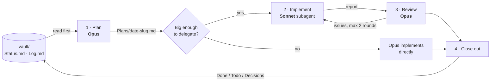

# plan-implement-review

[](https://github.com/Dead-Done/plan-implement-review/actions/workflows/validate.yml)
[](LICENSE)

A [Claude Code](https://claude.com/claude-code) skill that splits coding work across models:
**Opus plans, Sonnet implements, Opus reviews.** Along the way it keeps an
[Obsidian](https://obsidian.md) vault up to date, so the next session (or a different
agent, or a different account) can see what's in progress, what's done and what's left.

Built by **[Dead-Done](https://github.com/Dead-Done)**.

## Why

Two problems I kept running into with coding agents:

1. **Cost.** Running the strongest model for every step is expensive. Most of the
   tokens go into implementation (editing files, running tests, retrying), and that
   part rarely needs the strongest model once someone has worked out *what* to build.
2. **Amnesia.** Each new session starts from zero. Switching accounts, or handing work
   from Claude to Codex or Cursor, means re-explaining the whole project.

This skill handles both. Opus does the thinking-heavy steps (planning, review),
Sonnet does the token-heavy step (implementation), and a plain-Markdown vault
carries the project state between sessions.

## How it works



1. **Plan (Opus).** Reads the vault, explores the code and writes a concrete plan to
   `vault/Plans/`: exact files, signatures, snippets of existing patterns to copy,
   acceptance criteria and an out-of-scope list. The plan is the entire handoff, so it
   has to be specific.
2. **Size check.** Small changes (under ~3 files or ~150 lines) aren't delegated. The
   handoff overhead would cost more than it saves, so Opus just does them.
3. **Implement (Sonnet).** The `implementer` subagent follows the plan, runs the
   acceptance commands and reports exactly what changed and where it deviated.
4. **Review (Opus).** Reads the actual diff (not just the summary), runs the tests and
   writes a verdict to `vault/Reviews/`. Small fixes it makes itself. Larger ones go
   back to the *same* Sonnet agent, which keeps its context, for at most two rounds.
5. **Close out.** Moves the task from Doing to Done in `Status.md`, records follow-ups
   and decisions, and adds a line to `Log.md`.

## Does it actually save tokens?

It saves **cost**, not necessarily raw tokens, and only for the right tasks.

| Saves | Costs extra |
|---|---|
| Implementation runs on Sonnet, which is much cheaper per token than Opus | The subagent starts cold and re-reads files |
| Plans include snippets, so Sonnet explores less | Opus spends input tokens reading the diff during review |
| Fix rounds reuse the same agent instead of spawning a new one | Each fix round is another handoff |

It works best on large, mechanical changes like multi-file features, migrations, test
suites and boilerplate. It works worst on small, subtle fixes, which is why the size
check exists. I haven't published benchmark numbers. If you measure it on your own
workload, please open an issue with the results.

## Install

Requires Claude Code with access to Opus and Sonnet.

```bash
git clone https://github.com/Dead-Done/plan-implement-review.git
cd plan-implement-review

# macOS / Linux / Git Bash
./install.sh                    # skill + agent only
./install.sh ~/code/my-app      # also scaffold a vault in your project
```

```powershell
# Windows PowerShell
./install.ps1
./install.ps1 -Project D:\code\my-app
```

The installer copies the skill to `~/.claude/skills/` and the agent to
`~/.claude/agents/`. With a project path, it also creates `vault/`, `CLAUDE.md` and
`AGENTS.md` there. It never overwrites files that already exist.

Restart Claude Code afterwards so it picks up the new agent.

## Usage

Set your main session to Opus (`/model`), then:

```
/plan-implement-review add rate limiting to the public API endpoints
```

Open the project's `vault/` folder in Obsidian ("Open folder as vault") to watch
plans, reviews and status update as the work happens.

## The vault

```
vault/
  Status.md     Doing / Todo / Done / Decisions — the first thing any agent reads
  Log.md        append-only history: "- 2026-10-14 14:02 [implementer] added middleware"
  README.md     how the vault is organized
  Plans/        one note per task, with status in frontmatter
  Reviews/      one review per implemented plan
```

`CLAUDE.md` tells every Claude Code session to read the vault first and keep it
current. `AGENTS.md` does the same for other agents (Codex, Cursor and others that
read it). Everything is plain Markdown, so the vault works fine without Obsidian;
Obsidian just makes the wikilinks and history easier to browse.

## Repository layout

```
skills/plan-implement-review/SKILL.md   the workflow
agents/implementer.md                   the Sonnet implementer subagent
templates/                              vault, CLAUDE.md, AGENTS.md scaffolding
install.sh / install.ps1                installers
scripts/validate.py                     checks skill/agent/template structure (run in CI)
```

## Limitations

- A skill can't switch the main session's model. Planning and review run on whatever
  model your session uses, so set it to Opus.
- The quality of the result depends on the quality of the plan. A vague plan leads to
  rework, which eats the savings.
- If two agents write to `Status.md` at the same moment, one write can overwrite the
  other. `Log.md` is append-only to limit the damage, but this isn't a real lock.
- Review is stronger in a git repo, where Opus can read `git diff`. Without git it has
  to rely on the implementer's list of changed files.

## Contributing

Issues and PRs are welcome. See [CONTRIBUTING.md](CONTRIBUTING.md). Ideas I'd
especially like help with: real cost measurements, a tuned delegation threshold, and
support for parallel implementers.

## License

[MIT](LICENSE) © 2026 Dead-Done
